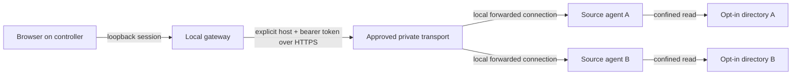

# MasterDrive architecture

Status: **v0.1 source architecture**, based on source inspection of `cmd/masterdrive`, `internal/agent`, `internal/catalog`, and `internal/server` during the initial build. This document does **not** assert deployment or network qualification. The product objective is a private Windows/Linux storage mesh with one virtual namespace and one interface: approved computers expose specifically authorized storage to each other across an encrypted private connection.

## Product boundaries

The storage fabric is **federated access**, not a distributed disk, RAID array, backup system, or pooled allocator. Every file stays on the owning computer; MasterDrive does not place blocks, replicate data, automatically select target disks, promise high availability, or make offline files available. Host removal is removal from the controller catalog, not remote credential revocation. The interface must not depict aggregate free space as one globally writable free-space balance.

### Components and trust boundaries

1. **Source agent (on each participating Windows/Linux host).** A local HTTP handler serves only user-configured absolute directory exports, with stable share IDs. Each request requires an independent bearer token. The source remains the authority for file bytes, share membership, and path confinement. In v0.1 the process binds only to loopback by default. Its exported data is read-only.
2. **Encrypted private transport.** The operator supplies an approved TLS/private-overlay route from the controller to an agent. Tailscale Serve is one practical adapter: it can publish a local service privately into an already authorized tailnet with HTTPS. It is **not bundled, automatically installed, or silently enabled** by MasterDrive. Other vendor-neutral TLS/mTLS or vetted mesh solutions can satisfy the transport contract. A bearer token does not protect data over plaintext remote HTTP. The code accepts `https://` peers and loopback `http://` for one-machine testing only.
3. **Controller/gateway.** A local loopback HTTP service exposes the browser UI and `/api/v1` facade. The gateway, never the browser, supplies a per-peer bearer token. Peer connections are only to explicitly registered origins; source data is streamed on demand. A local session is activated from a one-time URL fragment into a `HttpOnly`, `SameSite=Strict` cookie scoped to `/api/v1/`.
4. **Catalog.** A durable, versioned JSON list of explicitly added host origins, labels, and metadata. The registry stores no peer bearer tokens. Registrations are local CLI operations, not anonymous browser/API requests. Its status field is metadata, not an implicit live liveness claim.
5. **Browser.** The static UI renders hosts, shares, directory entries, and downloads from one same-origin gateway. It receives no source filesystem paths or peer credentials. The browser is not a privileged cross-network peer.

An operator must control **both** admission to the private network and admission to each exported share. Transport-level identity or network membership alone is not storage authorization. The gateway must validate TLS certificates and must not follow redirects that might forward bearer tokens. No controller-side remote file writes are supported by v0.1.

## Present v0.1 source behavior

- CLI roles: `masterdrive agent`, `controller`, `add-host`, `remove-host`. There is no unattended discovery, self-service pairing, or device enrollment yet.
- Agent exports use repeatable `-export ID=/absolute/path` and `MASTERDRIVE_AGENT_TOKEN`; a 32-or-more-character non-whitespace token is required. `os.Root` pins export roots and provides traversal-resistant path access, with a dependency on a sufficiently patched Go runtime. The source agent can list and download regular files. There is no upload, rename, delete, sync, copy-to-host, or capacity aggregation endpoint.
- Controller uses `MASTERDRIVE_PEER_TOKENS_JSON` keyed by catalog host IDs; tokens exist in process memory rather than the JSON catalog. This environment variable is operationally sensitive and not an ideal eventual credential store. The token map is loaded **at controller startup only**: after registering a new host, restart the controller with that host's credential or expect `403 peer_token_missing`. The controller re-reads the catalog before API reads so externally added/removed hosts are visible; catalog metadata changes do not rotate or revoke source credentials.
- The controller session URL is printed on startup; opening it once activates an API cookie. The controller serves the UI on loopback and rejects non-loopback `Host` values. Startup output containing the fragment is sensitive.
- Host listings currently report `status: "not_checked"`. That is deliberate: source code does not perform live health qualification or guarantee reachability.
- The catalog accepts origin-only HTTPS for remote peers, while plain HTTP is restricted to loopback testing. The gateway makes fresh requests rather than caching file contents or inventory.
- Linux and Windows support is a source-level target, **not** evidence of a tested cross-host Windows/Linux release. File-system semantics and transport configuration still require host-owned qualification.

## Lifecycle and authorization model

1. **Prepare device:** Install/launch the source executable under an appropriately restricted OS identity. Explicitly choose and validate which directory paths may be read. Never export a whole device, drive root, home directory, secrets folder, or NAS volume by accident.
2. **Choose transport:** Establish an approved encrypted route and its network policy; for Tailscale, enable an operator-managed tailnet, grants, and private Serve HTTPS only as authorized. Do not use public Funnel for the initial product.
3. **Enroll host manually:** Register its vetted HTTPS origin and a display name using the local CLI, then provide its separately generated bearer token to the controller through the existing environment variable mechanism. This is manual configuration, **not cryptographically authenticated pairing**.
4. **Browse/download:** Activate the controller session locally; browse through the gateway. Source ACLs, transport policy, bearer token, and export boundaries must all permit each request. A failed/offline source produces an error; there is no automatic alternate replica.
5. **Remove/revoke:** Remove the host from the local catalog and the controller's in-memory token mapping, rotate or revoke the source agent token separately, and adjust/revoke transport grants. Merely removing a catalog record does not revoke an already distributed secret or change tailnet membership.

## Architecture decisions and falsifiers

| Decision | Why | Falsifier / required check |
| --- | --- | --- |
| Federated namespace before distributed block pooling | Preserves existing file-system ownership and avoids silent data-loss/consistency promises | If users require a true single writable capacity pool, treat that as a separate design with placement, replication, quorum, failure and recovery models—not a UI option |
| Explicit export and host registration | Reduces accidental exposure and avoids hostile-device auto-admission | Unrecognized host or non-exported directory must be inaccessible under direct and encoded path requests |
| Private transport is replaceable | Tailscale is useful but the product should not depend on one vendor | Qualify another authenticated TLS route against the same protocol, identity, revocation and performance contract |
| Loopback control plane | Keeps browser session outside routable LAN by default | Non-loopback listen and DNS-rebinding Host attempts must fail |
| Read-only first | Enables useful multi-device navigation without risking source mutations | No HTTP method or endpoint may mutate an export; a negative security suite must exercise this |
| No inferred online status | Prevents stale catalogs from masquerading as host health | UI must distinguish `not_checked`, transport errors and real observed probes |

> **Hostile challenge:** Tailscale-style connectivity is not achieved merely by putting a web UI in front of a bearer-authenticated HTTP server. A genuine peer mesh needs admission, device identity, encrypted transport, key rotation/revocation, outage behavior, and operator-visible authorization decisions. The current prototype supplies a useful application-layer seam, not a complete mesh control plane.

> **Hostile challenge:** A read-only gateway can still leak sensitive data. Symlink/junction edge cases, Windows path special names, races against local file mutation, range response handling, TLS/redirect behavior, token exposure, and browser-origin attacks need platform-specific tests and review. Source inspection is not security certification.

## Milestones and release gates

**M0 — local read-only vertical slice.** Prove two explicit exports and a controller on loopback, session isolation, host removal, safe page traversal, range/download integrity, and error behavior. Unit/integration tests are evidence for the exact tested runtime only. Document Go minimum version and Windows/Linux cross-build status.

**M1 — private-network alpha.** On real Windows and Linux hosts, qualify TLS certificate-hostname verification, encrypted transport, authorized source admission, negative access tests across devices, revocation, link interruption/recovery, discovery of stale metadata, bandwidth limits and safe startup/shutdown. Add operator-friendly secure pairing rather than manually copied JSON secrets; credentials go into OS-appropriate secret custody. A successful local test is not a network qualification.

**M2 — mesh UX.** Offer approval-based device discovery, per-export visibility, capacity/status per real filesystem, multi-host search indexes with privacy and stale-state indication, verified peer identity, transfer progress, resumable/ranged downloads, device groups and ACLs, and observable audit trails. Keep transports interchangeable.

**M3 — authorized writes and mounts.** Design separately: share-scoped write grants, atomic upload staging, checksums, quota and conflict policy, optimistic concurrency/versioning, crash recovery, idempotency, and cross-platform FUSE/WinFsp or SMB/WebDAV adapter qualification. Do not enable writes by treating read-only endpoints as a file system.

**M4 — actual storage pooling (optional).** Requires independently specified replication/erasure coding, durability goals, placement, split-brain prevention, offline and degraded writes, rebuild, backup/restore and adversarial fault injection. Only then consider language such as "one disk" or "pooled capacity".

## Primary references and implementation precedents

- Tailscale Serve (private service exposure, HTTPS): https://tailscale.com/docs/features/tailscale-serve
- Tailscale grants and policy model: https://tailscale.com/docs/features/access-control/grants
- Tailscale encryption and device identity: https://tailscale.com/kb/1504/encryption
- WireGuard cryptokey routing: https://www.wireguard.com/protocol/
- Microsoft SMB features, signing and encryption: https://learn.microsoft.com/en-us/windows-server/storage/file-server/smb-feature-descriptions
- Linux FUSE behavior and permissions caveats: https://docs.kernel.org/filesystems/fuse/fuse.html
- rclone WebDAV server as interoperability precedent, not an endorsed dependency: https://rclone.org/commands/rclone_serve_webdav/

These references describe available technologies and constraints. They do not prove MasterDrive implements, integrates, or correctly secures any of them.
