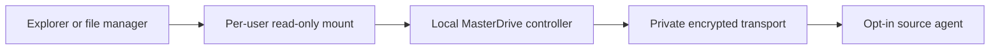

# MasterDrive: native read-only mount design (proposed)

Status: **design and acceptance plan, not implemented or host-qualified**, 2026-11-02. This document concerns a later Windows Explorer drive / Linux mount experience for the existing federated, opt-in storage architecture. It neither authorizes a driver installation nor enables access to any real disk. The source baseline uses Go 1.27 and has no WinFsp, FUSE, rclone, WebDAV adapter, or mount dependency in `go.mod`.

## Recommendation

Develop a **read-only, per-user mount adapter** above the existing MasterDrive controller. Keep transport, share authorization, and source path confinement in their existing layers. Do not introduce a writable filesystem, shared root/SYSTEM mount, or a pooled free-space illusion as part of this milestone.

Three stages provide a reasonable implementation route:

1. **M0 — stabilize the backing read contract.** Add authenticated `stat` by stable host/share/path, a paginated **snapshot- or cursor-consistent** directory enumerator, strong file-version validators or immutable opened-file handles for byte-range reads, and explicit offline/revocation errors. Add an OS-user-bound local service credential distinct from the browser's ephemeral session cookie. This is a prerequisite to a trustworthy native filesystem; today's `GET /v1/list` uses best-effort offsets and downloads have no source-issued strong ETag.
2. **M1 — optional experimental WebDAV bridge plus rclone.** A dedicated loopback-only, per-user bridge may translate the controller's read contract to a strictly read-only WebDAV subset. `rclone mount` is an *adapter option*, not the storage protocol and not a shipped MasterDrive feature. Test it on disposable shares with an operator-approved installation of WinFsp on Windows or FUSE on Linux; provide no default unattended mount or privileged service. Reject WebDAV mutation methods at the bridge, and also enable rclone's documented `--read-only` safeguard. A WebDAV bridge is **not present today**; pointing rclone at `/api/v1` or at Tailscale Taildrive's device-local Quad100 endpoint is not a valid native MasterDrive configuration.
3. **M2 — native adapters after M1 qualifications.** Implement one typed read-only storage interface used by a Linux FUSE daemon and a Windows WinFsp user-mode filesystem. On Windows, choose WinFsp's native API only if Windows-specific ACLs and high-fidelity filesystem behavior require it; the WinFsp FUSE compatibility API may reduce initial cross-platform duplication. The adapter should be a non-admin user-session process by default, with deliberate dependency installation and OS-specific signing/trust checks. Never silently register SYSTEM services, filesystem drivers, shell extensions, network providers, or auto-start mounts.

This design is **transport-agnostic**. The source agent still receives only requests via an explicitly approved private HTTPS/Tailscale Serve route. Taildrive is a separate Tailscale WebDAV product, not MasterDrive's peer transport.

## Trust and process boundaries

- The mount daemon has no authority to change the controller catalog or an agent's exports. A mount's source list is an **explicitly approved subset** of that user's already authorized shares. A local mount must not turn a controller's aggregate peer token map into a secret accessible by all local OS users.
- **Browser session cookies are not daemon credentials.** Add a separate mount-scoped local capability/IPC authentication path, with OS-user binding (`SO_PEERCRED`/protected Unix socket on Linux; secured named pipe or equivalent on Windows), expiry and revocation. Those identity mechanisms are proposals requiring native tests. An arbitrary process connecting to `127.0.0.1` must not gain the mount's server-side peer authority.
- On Linux, use a user-owned mount and do **not** set FUSE `allow_other` by default. Kernel FUSE documentation explicitly warns that access checks are the filesystem's responsibility unless appropriate permission options are enabled. On Windows, ensure the drive/mount's security descriptor limits access to the intended interactive user; a network drive mapping is not an ACL or remote share grant by itself.
- A mount-specific capability must be bound to one selected user, a stable allowlist of `(hostID, shareID)`, read-only scope, a finite lifetime, and the exact controller process. Source credentials never appear in command-line arguments, mount names, WebDAV URLs, world-readable config, logs, Explorer metadata or crash dumps when avoidable.
- An offline device or revoked grant must produce an explicit error. It must not be represented as an empty folder, zero-byte file, vanished replica, or a fallback peer with similar content.

## Stable namespace and filename rules

The canonical mounted path should be `hosts/<32-hex-host-id>/<share-id>/<relative-file-path>`. IDs are already the catalog's stable identity; display names are not authorities. UI presentation can show friendly host/share labels, but changing a label must not silently rename a mounted path or change the source of file bytes. A peer removal makes the canonical subtree unavailable; it is not credential revocation at the agent.

Every incoming OS path component must be validated and converted to the protocol's forward-slash relative path **without** accepting `..`, absolute source paths, device names or reparse/symlink escapes. Do not follow reported symlinks (the agent exposes link metadata without an authorized target). The mounted adapter must define a reversible rule or fail closed for characters/windows names that cannot be represented, trailing dots/spaces, Unicode normalization and case-fold collisions (`Report` vs `report`). Avoid silently hiding or aliasing collisions as though the namespace were complete.

**Metadata identity:** a hash of `(hostID, shareID, path)` can be an ephemeral display identity, not a stable source inode or durable Windows file ID across content changes. Stable file handles, generation/version fields, snapshots, change notifications, delete/rename behavior and `stat` are new protocol requirements. Current source listing offsets are not a consistent directory snapshot, and limits can truncate large folders.

## Filesystem operations: proposed backend contract

| Mount operation | Backing requirement | M0 status and safety behavior |
| --- | --- | --- |
| Get attributes / stat / lookup | Single-source metadata including type, size, times, stable version/ID and availability | **Missing:** list-parent is not a reliable substitute in huge or mutating directories; fail instead of fabricating metadata |
| Read directory | Consistent cursor/snapshot, deterministic ordering, explicit end vs incomplete | **Missing:** current offset pages can skip/duplicate entries during mutation |
| Open for read | Authorize share; pin file version for the lifetime of this open | **Missing:** source does not preserve version across multiple HTTP requests |
| Read at offset/length | Bounded `Range`, length validation, content-version condition and exact error propagation | **Partial:** single byte ranges exist; no source-issued strong ETag or immutable opened-file contract yet |
| Close | Release local read-handle state and cache references | Design-only |
| Write, truncate, create, rename, delete, chmod, link, locks | None in a read-only mount | Return explicit access-denied / read-only errors and never forward mutation requests |

For Linux FUSE the important operations include `getattr`, `readdir`, `open`, `read`, `release` and explicit read-only rejection of mutators. WinFsp's `FSP_FILE_SYSTEM_INTERFACE` describes `GetFileInfo`, `ReadDirectory`, offset-based `Read`, and many optional mutation callbacks; none should gain source-write privileges. Callback-specific return codes require native adapter tests, not mere HTTP status translation.

**Open-file consistency gate:** do not assemble `Range` responses from different versions. Require a strong, source-issued validator (or a remotely pinned immutable file handle), pass it on every read, reject changed/missing/mismatched validators and abort incomplete streams. Filename+size+mtime alone is insufficient. If the peer changes a file mid-read, surface an I/O/stale-handle error rather than mixing bytes or claiming successful EOF.

## WebDAV bridge pilot constraints

Implement only the minimum methods verified with the selected client: `OPTIONS`, `PROPFIND` depth 0/1, `GET` and `HEAD`, with identity-protected loopback access and strictly bounded XML responses. Explicitly deny `PUT`, `DELETE`, `MKCOL`, `MOVE`, `COPY`, `LOCK`, `UNLOCK`, `PROPPATCH` and any unrecognized mutator; test that clients do not reinterpret a denial as success. Support correct href XML escaping, percent encoding, `Content-Length`, single-range behavior, `ETag`/preconditions, directory collection identity and path canonicalization. The current API is JSON, **not WebDAV**, and none of these bridge methods is already implemented.

For rclone use the official WebDAV remote support and `rclone mount --read-only` only **after** the bridge exists and has passing interoperability tests. Windows rclone mount requires separately installed WinFsp; Linux uses FUSE. Keep the mount foreground and unprivileged for early tests. `--vfs-cache-mode off` avoids rclone's on-disk VFS content cache but can reduce filesystem compatibility; `--vfs-cache-mode full` explicitly buffers file bytes on disk and increases residual-data/revocation risk. Attribute and directory caches can retain stale metadata; configure short, measured TTLs and provide a clear manual refresh/unmount mechanism. Cache policy must never make revoked files seem freshly authorized. Avoid sharing the same rclone VFS cache between independent mounts or credentials.

Do not write a persistent rclone remote config containing MasterDrive bearer tokens as part of this prototype. The selected WebDAV client may require a credential; use a mount-scoped, short-lived loopback credential delivered by a protected user-only mechanism and document where each client stores it. Do not expose the bridge through Tailscale Serve/Funnel or publish its loopback address as a remote storage endpoint.

## Failure mapping requirements

These are semantics, not committed cross-platform error-code promises:

| Source/controller condition | Required user-visible result |
| --- | --- |
| Unregistered host or removed share | Object not found; no fallback to another host |
| Unauthorized, invalid, expired or revoked capability | Access denied; revoke/close related open mount handles and caches |
| Peer offline, DNS/TLS failure, timeout | Bounded network/I/O failure; do not claim empty directory or zero data |
| Stale `ETag`, mutation during open, inconsistent pagination | Stale-handle or I/O error; never mix file versions |
| Partial body, invalid `Content-Range`, unknown length | Read failure, not successful short read/EOF |
| Write attempt including an OS metadata probe with side effects | Read-only access-denied; verify remote bytes never change |

## Acceptance tests before recommending a mount to users

| Gate | Windows (WinFsp) | Linux (FUSE) | Pass condition |
| --- | --- | --- | --- |
| Fixture isolation | Non-admin, owner-approved driver; private temporary data | Non-root FUSE mount in a disposable directory | Only the approved share appears; teardown leaves no leaked mount or service |
| Read-only semantics | Explorer/PowerShell copy, create/rename/delete attempts | `ls`, `stat`, `cp`, write/truncate/rename attempts | Reads match source hashes; every mutation fails and source bytes remain identical |
| Identity and privacy | Multiple Windows users, elevated vs normal process; local named-pipe ACL | Different UID, `allow_other` absent, IPC permission | Another local user/process cannot reuse the mount's peer authority |
| Namespace fidelity | Reserved names, case collisions, Unicode, long paths, reparse behavior | Symlink/bind-mount escapes, Unicode and path normalization | No path escapes or silent file aliasing; collisions visibly fail |
| Network failure | Kill source during preview/read; TLS failure, revoke share | Same; unmount during blocked read | Bounded, accurate errors; no phantom empty file/offline replica |
| Versioned I/O | Random 4 KiB and >4 GiB offset reads under concurrent source mutation | Same with read-ahead and page cache | Every successful read belongs to one version or fails; no mixed chunks |
| Caches and revocation | Explorer thumbnails/search indexer, WinFsp cache, unmount | Kernel page/attribute cache, rclone VFS cache | Measured stale-age policy; revocation prevents new reads and forces cache invalidation/unmount as promised |
| Directory churn | Insert/remove thousands of files mid-enumeration | Same | Stable cursor or explicit incomplete/error; no false complete listing |
| Service lifecycle | Reboot, crash mount daemon/driver, drive-letter conflict | SIGKILL, reboot, mountpoint already busy | Clean recovery, no auto-start, no unintended cross-user mount |
| Private transport | Approved Windows/Linux Tailscale Serve or equivalent setup | Same | Actual two-host encrypted route and grants recorded; never Funnel |

Automated disposable CI can cover protocol mapping, parser, traversal, read-only mutation rejection and simulated failures. **Native manual host qualification** must cover filesystem drivers, OS permission identities, actual mount/unmount lifecycle, cache persistence, network overlays, and crash behavior. A green Linux/Windows Go test alone does not pass these gates.

## Sources and open questions

Primary sources retrieved on 2026-11-02:

- [WinFsp API](https://winfsp.dev/doc/WinFsp-API-winfsp.h/) and [native-vs-FUSE comparison](https://winfsp.dev/doc/Native-API-vs-FUSE/): user-mode filesystem callbacks, Windows ACL and Unicode differences.
- [WinFsp FAQ](https://winfsp.dev/doc/Frequently-Asked-Questions/) and [service architecture](https://winfsp.dev/doc/WinFsp-Service-Architecture/): Windows mountpoints, user-session vs service choices, privileged identity risks.
- [Linux FUSE kernel overview](https://docs.kernel.org/filesystems/fuse/fuse.html): daemon/owner semantics, mount permissions, kernel caches and connection abort behavior.
- [rclone mount](https://rclone.org/commands/rclone_mount/) and [WebDAV remote](https://rclone.org/webdav/): FUSE/WinFsp requirements, `--read-only`, VFS cache tradeoffs and WebDAV client configuration.
- MasterDrive source: `cmd/masterdrive`, `internal/agent`, `internal/server`, `docs/protocol-v1.md` at the v0.1/G1 source-inspection checkpoint.

Open decisions include: a reviewed Go mount binding and pinned dependency version; Windows driver distribution/licensing and signing policy; per-user capability IPC; exact stat/version/cursor protocol; collision naming policy; whether WebDAV's interoperability is sufficient to justify its additional attack surface; and how revocation interacts with OS page caches. None is implemented or qualified yet.

### Experimental observation-journal exhaustion (draft, not mount authorization)

The experimental generation journal in `internal/mountcontract/generation_journal.go`
has a 64 KiB on-disk cap. Opening a larger file fails closed; appending a
record that would cross the cap poisons the observer and denies subsequent
reads. No automatic compaction, marker deletion, or rollback recovery occurs.
This is an availability tradeoff, **not** an authenticated revocation store:
an attacker restoring both journal and owner marker can still roll back state.
An operator must design a separately authenticated checkpoint authority before
using the journal as a mount authorization prerequisite.

### Snapshot rollback falsification (2026-11-06)

The synthetic regression `TestJournalSnapshotRollbackIsNotDetected` proves
that restoring a previously valid journal after a higher generation was
observed lets the observer reopen at the lower generation. This is a
**known vulnerability**, not a test of safe revocation. SHA-256 record
checksums and exclusive owner markers cannot establish an external
anti-rollback anchor. Do not use this journal as pairing/revocation
authority or enable a mount based on its generation alone.

Required gate: trusted, independently persistent monotonic authority,
authenticated peer identity and per-share grants, revocation checks at
every staged read, and crash/recovery tests across Windows and Linux.
No production host or real drive is involved in this regression.
