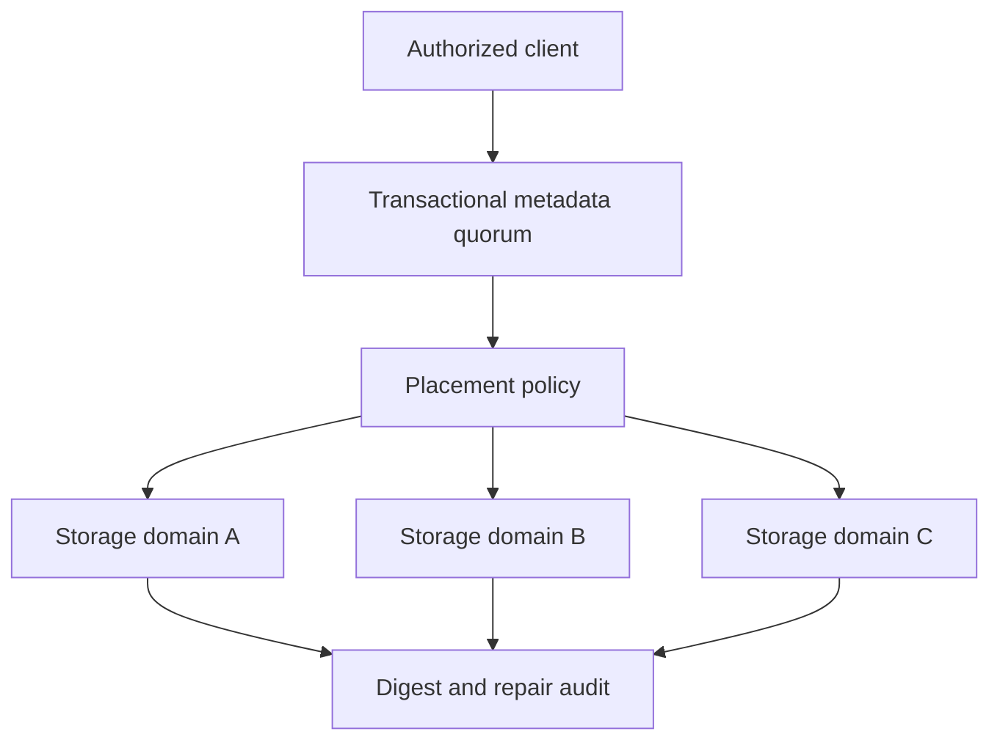

# ADR-G3: From a private storage mesh to actual distributed pooling

Status: **PROPOSED / research-only, 2026-11-02**. No pooled writable backend, consensus mechanism, erasure-code implementation, durability guarantee, or production release exists in MasterDrive. This ADR sets a high bar for using the word *pool*. It is not permission to install, repartition, format, or expose any host's disks.

## Decision

Keep the current *federated shares* namespace separate from any future *managed pool*. Existing `host/share/path` resources remain owned by their source host and may go offline; their free space is **not** combined into a writable logical capacity. A new pool must be an explicit opt-in namespace with its **own durable metadata, authenticated placement service, versioned immutable data objects, redundancy policy and recovery mechanism**. It must fail closed on unmet durability requirements rather than silently falling back to a single source drive.

**Preferred first implementation strategy:** make MasterDrive a secure control plane and client of a vetted, independently operated distributed storage engine, and qualify that engine on actual Windows/Linux hardware. Research direct adapters to an established object/filesystem backend before implementing consensus, erasure coding or a disk format in MasterDrive itself. The first possible managed-pool prototype should use simple, inspectable **3-way replication across three independently failing nodes**; erasure coding is a later optimization whose placement and rebuild tests have passed. This is a design preference, not a claim that any candidate is already compatible with intermittently connected personal laptops.

### Why a web catalog does not constitute pooling

The existing UI and controller route reads to explicitly registered source agents. They do not own file versions, place chunks, commit metadata, protect against power loss, or repair a failed disk. If the sole source is lost, the file is lost. Even a displayed sum of free bytes would double-count volumes shared through multiple exports and say nothing about allocatable, durable bytes. The G3 feature must not inherit optimistic availability claims from the G0/G1 federation.

## Primary-system comparison

| Reference | Documented architecture | MasterDrive design lesson | Caution |
| --- | --- | --- | --- |
| [CephFS](https://docs.ceph.com/en/latest/cephfs/) / [CRUSH](https://docs.ceph.com/en/latest/rados/operations/crush-map/) | POSIX filesystem on RADOS, distinct metadata and data pools, MDS journal; failure-domain-aware replicated/erasure-coded placement | Separate namespace transactions from replicated bytes; model host/rack failure independence explicitly | Operationally demanding cluster and versioned clients; `latest` CRUSH docs reflect a development channel, not a pinned deployment [E1, E2] |
| [JuiceFS Community](https://juicefs.com/docs/community/architecture/) / [cache](https://juicefs.com/docs/community/guide/cache/) | Metadata engine maps files/chunks/slices to object-store blocks; client FUSE access and cache, close-to-open consistency | Keep immutable data IDs, transactional metadata references and client caching as distinct correctness concerns | Metadata engine and object store become external dependencies; writeback can make metadata visible before object upload [E3, E4] |
| [SeaweedFS](https://github.com/seaweedfs/seaweedfs/blob/master/README.md) / [architecture PDF](https://github.com/seaweedfs/seaweedfs/wiki/SeaweedFS_Architecture.pdf) | Master tracks volume locations, append-only volume servers replicate/erasure-code at volume level, filer stores directory metadata separately | Volume-level layout, repair and metadata stores are independent subsystems, not free features of a file-list UI | Hot-data replication and erasure coding for warm data are not universal guarantees; `master` docs are mutable and the linked PDF was not independently retrievable [E5, E6] |

Evidence IDs refer to the append-only [research record](research/pooling-evidence.md). This comparison describes upstream projects' official documented contracts; it is **not** a benchmark, adoption decision, security audit or endorsement. No storage-engine dependency is currently declared in MasterDrive's Go module.

## Proposed G3 data model and trust boundaries

1. **Pool enrollment and policy.** Only an authorized owner can enroll a dedicated pool path/volume. It records physical host ID, logical pool ID, OS/filesystem, failure-domain tags, capability, capacity reserve, availability and supported protocol version. Enrollment never auto-claims an entire disk, home folder, source export, or externally mounted NAS. Different path aliases to the *same physical disk* must not be counted as independent failure domains.
2. **Identity and authorization.** Network membership and a generic agent bearer token are not write authority. Bind a pool writer/reader to independently revocable device identities, pool-specific grants and short-lived credentials. Explicit owner approval and anti-replay are mandatory. Tailscale (or another private encrypted transport) carries traffic; MasterDrive still enforces source/pool authorization.
3. **Metadata authority.** A transaction-capable replicated metadata service owns the namespace and immutable file-version manifests: path, generation, writer identity, chunk hashes, logical length, placement policy, committed replica locations, timestamps and audit reference. Every create/rename/delete requires an atomic compare-and-swap or transaction. Epoch/term fencing prevents an old leader from committing after partition. No success ACK from a lone local JSON file.
4. **Data plane.** Chunks are immutable and content-verified (e.g. SHA-256), written to named pool targets using least privilege and authenticated encryption. A *staged* chunk is not a committed file version. Replicas or erasure shards must land on distinct declared failure domains, with a digest and durable-write acknowledgement from each required node. Data reads verify the manifest's expected digest and version; corrupted replicas are quarantined and repaired from verified survivors.
5. **Placement/recovery controller.** Given file size, quotas, host reachability, capacity and failure-domain policy, it chooses valid targets and schedules bounded, idempotent repair. Each repair uses a new generation/placement revision so racing repairs cannot overwrite current file data. It never asserts a healthy replica from stale last-seen metadata.
6. **Client semantics.** Advertise an explicit contract (initially whole-file atomic replace and read-after-commit) before POSIX locks, open-file write semantics or Windows drive letters. File handles have version tokens; offset/range reads cannot be spliced across versions. Offline clients receive a truthful error or a clearly version-labelled read-only snapshot, never an implicitly writable stale copy.

### Commit protocol candidate (whole-file replace, replicated prototype)

This is an **inference/design proposal**, not a copied Ceph/JuiceFS/SeaweedFS protocol:

1. Obtain an authorized operation ID and current namespace generation from metadata quorum; reserve the intended quota and distinct placement targets. Reject if there are insufficient healthy domains for the requested policy.
2. Stage immutable chunks on selected targets; verify end-to-end hashes, the intended tenant/pool, and durable persistence before counting each distinct-domain acknowledgement. Timeouts, partial writes and retries are idempotent by operation ID and hash.
3. Only after the required placements are durable, commit a manifest/new namespace generation in a fenced metadata transaction. An ACK is issued **after** this commit is durable. A failed/quorum-lost commit leaves unreferenced staged chunks, not a partially visible file.
4. A reader resolves a committed manifest generation, reads only verified chunks in that version, and fails if the policy cannot serve safe data. Do not silently cross versions when resuming. Deletions and overwrites create tombstones/new versions; garbage collection occurs only after a bounded retention/lease/audit period.
5. Repair continuously compares committed placement manifests with attested healthy replicas. If a domain disappears, reconstitute a replacement on an *independent* domain, checksum it, and transactionally update placement. Never count a replica until reconstruction and persistence both complete.

**Critical semantic choice:** Do not enable writeback acknowledgements based only on a laptop's transient local cache. The upstream JuiceFS cache documentation shows why commit-first/asynchronous-upload needs its own data-loss contract. For MasterDrive's initial durability objective, use upload-and-durable-placement **before** namespace commit [E4].

### Capacity accounting

- Physical raw bytes, allocated/reserved bytes, logical user bytes, repair reserve and advertised usable bytes are separate fields with timestamps and uncertainty. Do not sum per-export capacity; two exports may map to one filesystem.
- With three full replicas across three independent hosts, a rough raw-to-logical ceiling is `sum(eligible bytes)/3`, **before** fragmentation, metadata, imbalance, reserved rebuild headroom and loss of a domain. Not a guaranteed free-space number.
- A hypothetical `k+m` erasure code needs at least `k+m` independently placed shards under its declared failure policy. `k=4,m=2` cannot truthfully withstand two host failures if two shards reside on one host. Never lower redundancy because only two machines happen to be online.
- Enforce per-pool and per-identity quotas; fail a write if it cannot meet *all* of placement, quota and durable ACK requirements.

## Failure model to specify before coding

| Event | Required observable behavior | Evidence needed |
| --- | --- | --- |
| Writer crashes before commit | No new visible file version; staged chunks recoverable/collectable by operation ID | Kill at each protocol step |
| Node dies after acknowledged write | File remains readable from independently verified survivors within declared tolerance; repair status becomes degraded until complete | Power-off, disk removal, checksum comparison |
| Two sites partition | At most one metadata majority can commit; minority rejects writes with explicit error; old leader fenced | Network partition and rejoin with conflicting writer attempts |
| Disk full/hot unplug | No silent reduction of durability; try another eligible domain or fail, release quota reservation safely | Fault injection with capacity exhaustion |
| Silent bit flip / stale chunk | Digest mismatch surfaces; corrupt copy quarantined, never returned as valid bytes; repair only from verified source | Deliberate corruption of one replica/shard |
| Metadata corruption/loss | Transaction log/checkpoint restores consistent namespace and manifests without pointing to missing data | Restore from backed-up metadata, replay, consistency scanner |
| Key compromise / revocation | New reads/writes denied after effective revocation boundary; old ciphertext not misrepresented as cryptographically erased | Identity rotation tests and key-recovery drill |
| Clock skew / offline peer | Leases and epochs use monotonic/quorum decisions; stale status never becomes healthy | Skew, delayed messages, offline→online replay |

Windows junction/reparse-point attacks, Linux symlink/mount races, untrusted peer data, interruption mid-rename, and unexpected control-plane restarts must be in the matrix. Test the actual supported Go/runtime and filesystem versions; a source-level passing test is not proof across all hardware.

## Stage gates (must pass sequentially)

### G3.0 — decision and prototype envelope

- Choose a **pinned, maintained backend release** and document license/operating model, Windows/Linux client support, metadata dependencies, failure model, supported native mounts and how it handles independent laptops. Obtain an independent architecture/security review. The current upstream `latest`/`master` comparison is insufficient for a build decision.
- Define the exact persistence contract, encrypted transport and storage key lifecycle, namespace isolation, quotas, API schema, auth/grant/revocation, minimum independent-domain count, recovery-point and recovery-time objectives. Model current storage owner paths as **read-only, never automatically enrolled**.
- Formalize proof obligations as executable state-machine/property tests for commits, retries, CAS generations, split brain and deletion/GC; include a hostile threat model for metadata/key compromise and physical device theft.

### G3.1 — single-host disposable simulation

- Implement only a test harness with one namespace and fake storage targets before enabling remote writes. Fault-inject between **every** stage/ack; an uncommitted version must never appear and a successful ACK must correspond to a committed manifest and required durable placements.
- Property-test random operation histories, retry duplication, interrupted uploads, malformed peer responses and deliberate hash mismatches. Maintain an oracle of committed namespace versions and byte hashes. Zero silent mismatches in the full recorded test corpus.
- No writes to user-exported folders, partition tables, drive roots or default catalog. Disposable, bounded test paths only; CI snapshots and fault seeds retained.

### G3.2 — controlled three-node lab

- Require three separately powered/failed devices or independent failure domains for 3x replication, not three paths on one disk. Record hardware serial/failure-domain mapping, OS/filesystem versions, transport security and a fixture dataset (at least 10,000 small files, 100 mixed large files, and a multi-GB sequential sample) with an external SHA-256 oracle.
- After acknowledged writes, kill/power-cycle one node, unplug one volume, simulate full disks and network partitions. Verify **100% of acknowledged test objects and metadata** against the oracle after repair; no unacknowledged object may become visible. A test pass proves only the tested fault model and workload.
- Demonstrate quorum loss prevents writes, split brain cannot commit conflicting generations, changed keys/revoked clients are denied, repair never copies corrupted bytes, and a new clean node can be rebuilt from surviving independent replicas. Record RPO/RTO and p50/p95/p99 latency with hardware context, not arbitrary universal benchmarks.
- Validate restore of metadata and encryption keys from separate protected backups. Replication alone is **not backup**: also test snapshots, deletion recovery, ransomware containment, and restoration without the primary cluster.

### G3.3 — cross-platform pre-release qualification

- Repeat the lab with supported native Windows and Linux filesystems, NTFS junctions and reparse points, symlinks, ACLs, case-collisions, Unicode normalization, open-file replacement, metadata/filename semantics, delayed writes and unclean power loss.
- Independent security assessment of enrollment, tenant/share isolation, certificates, key rotation/revocation, path confinement, operation replay, malicious peers, signed-upgrade provenance and artifact verification.
- No mount letter/FUSE write support until collision, lock, lease, fsync, rename, delete, sparse-file and crash-consistency semantics are specified and tested. Distinguish a read-only namespace mount from a writable filesystem.
- Publish release notes enumerating measured failure tolerance and unsupported configurations, with documented stop/disable and backup/restore operations. Ship no automatic migration from existing opt-in read-only exports.

## Explicitly rejected shortcuts

1. **Advertise a sum of drives as usable pool space.** Multiple exports can share a disk and replication consumes independent capacity.
2. **Acknowledge on one laptop then copy later.** An acknowledged write is not durable if that laptop disappears before replication.
3. **Treat Tailscale membership as file write permission.** Private transport still requires fine-grained pool identity and authorization.
4. **Trust a single JSON registry or one controller as consensus.** Concurrent writers and partitions demand transaction/fencing semantics.
5. **Rely on file size and modification time as strong content identity.** Version manifests and checksums are needed before range resumes or repair.
6. **Count two folders on the same disk as two replicas.** The failure domain is the actual disk/host/rack, not the path string.
7. **Set up erasure coding before repair and disaster testing.** Coding is not recoverability until placement and reconstruction work under failure.
8. **Promise offline writes without conflict semantics.** The initial policy is to reject offline writes, not silently fork a writable namespace.
9. **Delete last good copies during rebalance or garbage collection.** Only committed, fully verified replacement placements may supersede old data.
10. **Call replication backup.** Accidental deletion, credential compromise and ransomware can replicate too.

## Open decisions

- Should MasterDrive manage a separate operator-installed backend (e.g. CephFS or an object store), or embed a narrowly scoped storage engine? The first option is preferred pending cost, UX, licensing and host-lifecycle trials; no version has been selected.
- Is the first managed pool S3/object semantics, whole-file atomic replace, or true POSIX? Recommend whole-file replace first, but the product owner must choose the externally promised contract before implementation.
- What failures are actually independent in a home tailnet (laptops sleeping, one house power circuit, one router, same shared UPS)? Pool eligibility must reflect reality, not host count.
- What recovery and performance objectives are meaningful for the user's hardware and data criticality? Thresholds require a separately authorized, instrumented lab.
- Who owns key escrow/recovery, and which source identities may read, write, repair or administer each pool? No invented default.

Research completion remains pending independent verification of [the evidence log](research/pooling-evidence.md). This ADR deliberately does not initiate a deployment or present software that does not exist.
