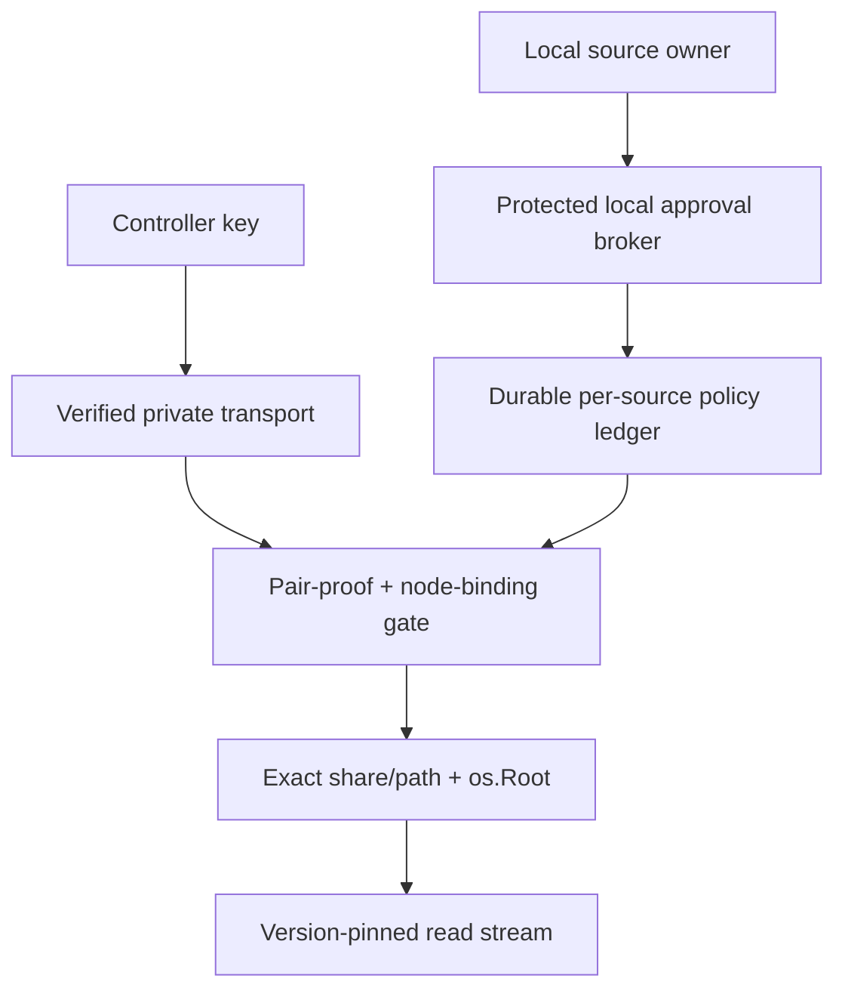

# MasterDrive G2/G3 pairing integration contract (source-only)

**Status:** DESIGN / SOURCE INSPECTION, 2026-11-02. G1 main source: [`d82e69f8`](https://github.com/thebrazenbeard/masterdrive/commit/d82e69f8c9c82e846bd9b118c7ffa8dc9ef2025b); G2 candidate: [draft PR #4](https://github.com/thebrazenbeard/masterdrive/pull/4). **Not a live pairing service, installed mount, validated transport, or security qualification.** Target: Windows and Linux; $0 mandatory spend; owner-granted data only.

## Literal proposition and hostile verdict

> **H1 FAILS:** “Membership in the same tailnet authorizes a share.” Tailscale distinguishes users, tagged nodes, and node identity; its network grants cannot replace the exporting machine owner's **share-specific** consent. [Tailscale identity](https://tailscale.com/docs/concepts/tailscale-identity).

> **H2 FAILS:** “The G2 in-memory registry provides durable revocation.” It has no persistence, no protected local owner broker, and its cancellation context is not wired to a real file-copy pipeline. Restart forgets all pairs (fail closed for new requests), and a process retaining old authority or an already-writing handler is unqualified.

> **H3 UNKNOWN:** “We can introduce pairs without leaving an agent-wide bearer bypass.” G1's `NewHandler` and `NewHandlerWithGrants` authorize bearer tokens on every current source endpoint. Any `pair-only` mode must remove that bypass by construction, with adversarial tests before use.

## Current exact source boundaries

1. **Source agent:** `cmd/masterdrive/agent.go` on G1 main binds the agent to loopback, takes explicit `-export ID=folder` shares, and configures *either* legacy `MASTERDRIVE_AGENT_TOKEN` or opt-in scoped `MASTERDRIVE_AGENT_GRANTS_JSON`. `internal/agent/agent.go` authenticates an HTTP Bearer secret, checks the resulting share set, and uses pinned `os.Root` filesystem handles. There is no owner-local pairing action or network node identity validation.
2. **Controller:** `internal/server/server.go` holds peer bearer secrets in memory keyed to *catalog IDs*, not cryptographically verified host IDs. It sends credentials to registered HTTPS origins, blocks redirects, and never exposes tokens to the browser. Catalog registration is not permission to export new source folders.
3. **Pairing candidate:** `internal/pairing/registry.go` on PR #4 implements low-level Ed25519 invite proof, explicit pending/confirmed states, share-scoped signed `list`/full-file-`download` requests, bounded replay cache, permission epochs, and revocation/cancellation notifications. It is intentionally **not attached to HTTP**. The same signed protocol **does not** authorize search, pagination/filter variants, `Range`, or `If-Range`.
4. **Transport:** G1's documented Tailscale Serve pattern terminates tailnet HTTPS and proxies to an agent listening on local loopback. MasterDrive does not import or configure `tsnet` (main `go.mod` uses Go 1.27.0, with no Tailscale dependency). A Tailscale account, host name, connected status, catalog entry, or caller-controlled header is **not** a source-side owner grant.

## Trust boundaries and recommended order

The arrows name **future** components/contracts, not implemented routes. The owner broker and the data-plane agent must use different permissions where possible. A browser controller or remote client must never acquire owner authority merely by being paired.

### Gate P0 — local owner intent and process separation

- Source owner chooses exact **source-owned, owner-approved share IDs from the configured export registry**, granted read operations, controller Ed25519 public key, expiry and retention policy. G1's `-export ID=folder` ID is owner-chosen; a controller cannot invent an export or override its share ID. Neither a remote HTTP request nor a catalog display name can trigger consent.
- Windows: use an owner-restricted named pipe with an explicit security descriptor and verified caller SID/token; Linux: restricted Unix-domain socket with OS peer-credential check plus filesystem permissions. Prefer a separately permissioned broker process, not the untrusted web handler's process identity. **These checks distinguish OS users, not malicious software already running as the approved owner**; a same-user attacker may impersonate caller intent. Owner confirmation needs a separate, independently qualified interactive consent mechanism, and a same-user compromise remains outside any proven guarantee. **Do not** implement owner approval as an unprotected loopback HTTP `POST /approve`, browser `Origin` check, bearer admin token, or writable JSON file.
- Give the broker narrow methods: `InviteLocal(key, shares, ttl)`, `InspectPendingLocal(id)`, `ConfirmLocal(id, independentlyVerifiedFingerprint)`, `RevokeLocal(id)`, `InspectEffectiveGrantsLocal()`. The broker owns ACL and audit decisions. The transport-facing agent may request verification but cannot call privileged operations on behalf of a remote client.
- Invitation delivery and key-fingerprint comparison require an approved independent channel; the source owner confirms the **full** fingerprint with the intended controller owner. Invitation redemption creates **pending**, which authorizes zero reads until local confirmation. Local notification can identify pending state but must never auto-approve.
- Threats to falsify: another local unprivileged process can approve, a malicious web page can induce confirmation, an arbitrary remote request can call broker methods, or a leaked invite can choose a different key/share set.

### Gate P1 — per-request app identity **plus** transport identity

- The G2 Ed25519 public key is an **application controller identity**, not automatically a Tailscale machine key, Windows SID or Linux UID. Each source owner binds that key to permitted shares and, if strict node pinning is required, a separately verified transport peer identity.
- Preferred **strict tailnet-node pilot:** run the data-plane HTTP listener through a separately consented, version-pinned `tsnet.Server.Listen` interface. For requests on **that exact listener**, use `Server.LocalClient().WhoIs(r.Context(), r.RemoteAddr)`, review returned node identity/user/tags and match the source-owner-pinned node binding. A failed lookup or changed node identity is denied, not silently reclassified. `tsnet` is **not installed** in G1; its embedded node requires separately reviewed state, credential handling, tailnet admission and $0 suitability. [Official tsnet docs](https://pkg.go.dev/tailscale.com/tsnet).
- **Existing Tailscale Serve pilot:** Serve can add user identity headers after filtering caller-supplied copies, but tagged callers do not receive those user headers; a directly callable backend can be spoofed. The agent sees a local reverse-proxy connection rather than a trustworthy raw remote node socket identity. Do **not** call `WhoIs` on a Serve backend's `r.RemoteAddr` and claim it names the original tailnet controller. A Serve-backed trial may rely on independently verified **app signing keys** and Serve's network restriction, but must label node binding **UNVERIFIED**, or add a separately authenticated, explicitly reviewed assertion mechanism. [Official Serve identity-header limits](https://tailscale.com/docs/features/tailscale-serve).
- **Transport-neutral alternative:** mutual TLS with certificate/public-key pinning (and authenticated owner-local enrollment) can establish a channel identity independent of the tailnet. Specify certificate rotation, pin changes and stolen-key recovery before enabling; never substitute permissive `InsecureSkipVerify` or an arbitrary Host header. Do not require paid hosted components.
- Auth decision `ALLOW` requires every configured gate: transport/peer identity check (if strict mode), confirmed unrevoked app key, current epoch, signed canonical intent, explicitly allowed share, and confined filesystem target. **Network approval cannot expand a share grant.** No cross-mode downgrade on verification failure.

### Gate P2 — canonical HTTP signed intent and source authority

- Replace raw trust in URLs with a single canonical `ReadIntent`: version; pair identity; operation; exact logical share ID/path; immutable file version for downloads when M0 exists; semantic query/filter/pagination/range fields; expiration/nonce; permission epoch; and, when qualified, transport channel/node binding. Sign/verify one canonical byte format, never reconstruct a different path after authorization.
- **For the current G2 proof v1**, permit only a *full* listing of the exact folder and a *full* download of the exact regular file. Reject all search, `Range`, `If-Range`, conditional requests, browser-controlled sort/filter/pagination or unrecognized response-changing parameters **before** file open. Do not silently add a route that reads unsigned semantics.
- Authenticate *every* data-plane operation before opening the share; pass a verified immutable authorization context into the source's existing `os.Root` handlers. Explicitly reject symlink/reparse escapes, mutated request path, wrong share IDs and wrong controller key. Never materialize an export path from controller parameters.
- Build a pair-auth handler as a **separate constructor** (`NewHandlerWithPairAuthorizer` or equivalent) rather than inserting optional checks into the existing bearer path. Legacy bearer API remains available only when the owner explicitly selects the legacy mode.

### Gate P3 — durable policy, replay and rollback

- Introduce a per-source, owner-protected durable policy ledger with schema/version and atomic transactions for `invited → pending → confirmed → revoked`, share set, controller-key digest/fingerprint, transport pin, epochs, and audit sequence. Store *public* keys only where possible; keep controller private signing keys in OS-protected per-user storage. Require strict file/parent-directory ACLs and safe exclusive instance ownership on Windows and Linux.
- A revocation begins by acquiring a **source-owned authorization fence synchronized with every `Authorize` / `AuthorizeStream` lease admission**. Flip the in-memory state to `revoking/denied` while holding that fence, *before* any potentially slow disk transaction. Do not permit a new authorization to enter or acquire a lease while the deny epoch is being persisted. This must cover the complete check-and-lease transition, not only an earlier boolean lookup.
- A successful owner-facing revocation acknowledgment requires the new denied epoch to be durably committed, fsynced (including relevant journal/metadata and parent directory as applicable), **read back or transactionally validated**, and then exposed as authoritative state. If persistence fails or times out, retain the in-memory denial fence and report **failed/unconfirmed persistence**; never roll back to an allowed in-memory state or retry a stale epoch. On crash/restart, corrupt, incomplete, or uncertain ledger state denies paired reads pending owner recovery.
- A crash **before the first durable denial intent** cannot be assumed recoverable from an unchanged old ledger. Design an explicit fail-closed restart/admission gate or independent monotonic anchor if the product promises denial immediately from the start of a revoke attempt. Rollback from restored older ledger copies remains a separate unsolved attack absent an external monotonic anchor; do not claim rollback resistance from SQLite WAL alone. The same fence/ledger ordering must be coordinated across **all** serving processes, or multi-process pair mode is unsupported.
- Replay nonces currently live in process memory. If paired authorization is made durable across restart or multiple processes, either persist the nonce window atomically **or** rotate an unpredictable boot/instance challenge that every signed request commits to. Unknown epoch, duplicate nonce, time skew or stale signed intent must fail closed.
- Distinguish revoking one pair identity, rotating its key, removing a share, removing a catalog entry, and changing tailnet grants. These have different effects. G2's one-key-one-pair policy means revocation cancels that controller's **entire** approved share set; the local UI must explain that choice.

### Gate P4 — stream lifecycle and true revocation

- Acquire a **revocable in-flight lease for both `list` and `download`**, under the same source-owned authorization fence, **before** opening a file or starting a directory iterator/`ReadDir`. Link each lease's context to the request and exact authorization version. Each directory traversal/pagination step and each file-copy iteration must observe cancellation and stop; release the lease on every exit path. A one-off `Authorize` that returns success and leaves an untracked long-running listing is insufficient. The handler must also close/abort outbound streams as supported by its HTTP transport, and must not resume an old range without M0 strong file-version proof.
- Revocation order: (1) acquire the source-owned fence shared by *all* authorization/lease paths, set `revoking/denied`, and atomically forbid new leases; (2) signal cancellation to already-issued **listing and download** leases while denial remains fenced; (3) durably commit and fsync the new epoch/denial, read back/validate and acknowledge only on success; (4) on persistence failure retain denial and escalate an unconfirmed durable-state error; (5) verify effective denial from a fresh connection and that active handlers stopped; (6) separately revoke/rotate legacy credentials or tailnet permissions as required. If a slow fsync blocks, new authorizations must fail/queue behind the fence and must never pass using the previous epoch.
- No source-only cancellation context can promise that bytes already in a socket or intermediary buffer are recalled. The acceptance metric must distinguish `new opens = 0 after revocation commit`, `handler writes cease within tested bound`, and `remote received bytes may include prior buffered data`.

### Gate P5 — migration from current bearer configuration

| Owner-selected mode | Source API authorization | Migration behavior |
| --- | --- | --- |
| `legacy-only` (existing default) | Existing G1 bearer grants | Explicitly marked legacy; no claim of pairing or live revocation |
| `pair-only` (future opt-in) | Verified pair proof and configured transport gate | **No bearer fallback**, including search/list/download or after failed signature |
| `dual-explicit` (temporary controlled transition) | Separately and visibly authorized bearer **or** paired identity | Test-fixture / migration only; show that bearer revocation is independent; never silently enter dual mode |

No mode should be chosen from untrusted HTTP headers or `Accept` negotiation. Source owner chooses at process startup or through the protected broker; effective policy is inspectable locally and persists coherently. On cutover to `pair-only`, stop/drain legacy listeners, remove old secrets from every controller, verify bearer probes fail, confirm source owner action and keep rollback plan. A pair revoke must not silently leave an all-share legacy token usable.

## Acceptance suite (pre-deployment, two disposable hosts)

| ID | Negative/falsifier | Pass evidence needed |
| --- | --- | --- |
| P-01 | Distinct unprivileged OS user or remote web page attempts owner confirmation or grant edit | OS-level owner broker rejects it; recorded SID/UID without private data. Same-owner-user malware resistance remains UNKNOWN and must not be claimed |
| P-02 | Wrong Ed25519 key, stale/expired pending invite, wrong fingerprint | Every path denied before file open; one-use invite remains bound to original key |
| P-03 | Confirmed key tries other share, alternate path, Windows reserved or reparse path | Generic denial/no bytes/no source paths; `os.Root` proof and native Windows fixtures |
| P-04 | Serve local proxy presents spoofed `Tailscale-User-*` / tagged peer | Header-only identity never authorizes read; strict node mode rejects unverified origin |
| P-05 | Direct tsnet listener receives approved app key from wrong node or unmapped `WhoIs` | Denied with no downgrade; exact pinned node identity read back |
| P-06 | Owner switches `pair-only` then old/all-share bearer credential is retried | All legacy API routes reject bearer even after pair signature failure |
| P-07 | Reuse signed proof/nonce or alter unsigned query/Range/path after signature | Replay and modified semantics fail; only exact full-list/full-download v1 route allowed |
| P-08 | Hold revocation fsync deliberately slow while concurrent `Authorize` and `AuthorizeStream` calls race; inject disk error and crash before/after intent/commit | **No new auth or lease after in-memory deny fence**, no success acknowledgment until durable commit/readback, error retains deny fence; restart from uncertain ledger fails closed; rollback limitation explicitly gated unless anchor proven |
| P-09 | Revoke during a blocked directory `ReadDir`/iterator **and** a separate blocked file-copy writer | Both listing and download leases receive cancellation; no new opens/traversals after fence; actual list/write loops stop within measured bound; lease counts return to zero |
| P-10 | Device key rotated/tag changed, tailnet access revoked or source offline | Denial visible, no fallback to stale catalog or legacy credential |
| P-11 | Owner removes a catalog host | Only local metadata changes; source credential/pair remains independently valid until explicit owner revocation |
| P-12 | Flood invitations, nonces, pending approvals or send concurrent revocation | Capacity limits and fail-closed results hold under Windows/Linux Go race tests |

All tests require exact source SHA, Go/toolchain version, OS, transport/Tailscale version, owner and tailnet-admin authorization, evidence of denied *connections versus HTTP 401/403*, teardown, and independent hostile review. Green unit CI proves source behavior only, not live Tailscale grants or OS isolation.

## Implementation slices and gates

1. **G2.1:** Keep PR #4 low-level source-only, compile and race-test its packages; preserve all deny-only tests. No service endpoints.
2. **G2.2:** Implement and OS-qualify the local owner broker, its ACL boundary, audit sequence and long-lived key storage without any remote listener; test unprivileged caller rejection on Windows and Linux.
3. **G2.3:** Select one authenticated transport and pin exact identity semantics. Test direct tsnet WhoIs against two *authorized disposable* nodes or independent mTLS, including mismatch/rekey/revocation. Do not quietly switch to public Funnel or unauthenticated Serve headers.
4. **G2.4:** Wire pair-only data-plane authorization for a deliberately small subset of full-folder lists and full-file downloads, with no unsigned variants; check parity with G1 confinement and source redaction tests.
5. **G2.5:** Add durable epoch/replay management, live stream lease enforcement, restart/crash tests and bearer-to-pair cutover logic; block merge to production until all P-01–P-12 gates have evidence.
6. **G3:** Only after M0 immutable read metadata and honest two-host proof, integrate the read-only WebDAV/mount pilot. Writable pooling/replication needs a separate consistency and failure-domain design; pairing does not solve it.

## Evidence classes, owners, open choices

- **SOURCE:** G1 `d82e69f8` and G2 PR #4 contain the code shapes described above.
- **RETRIEVED:** [Tailscale identity](https://tailscale.com/docs/concepts/tailscale-identity), [Serve](https://tailscale.com/docs/features/tailscale-serve), [tsnet](https://pkg.go.dev/tailscale.com/tsnet), [Go net/http](https://pkg.go.dev/net/http).
- **INFERENCE:** Direct tsnet WhoIs has stronger peer-node provenance than an HTTP request delivered by a Serve loopback proxy; it must still be tested in the actual selected version/configuration. mTLS can serve as a transport-neutral alternative if correctly pinned.
- **UNKNOWN:** Owner broker identity boundary, persistence/rollback anchor, tsnet/mTLS selection, approved host pair and tailnet rules, revoke write/stream latency, native mount backend.

Before work affecting Lappy/VN1/VN2 or an admin tailnet, obtain exact folder and participant permission, create disposable fixtures, and preserve existing Tailscale Serve/Services/policy state. Neither source publication nor this document authorizes unattended real-drive export or network-policy mutation.
